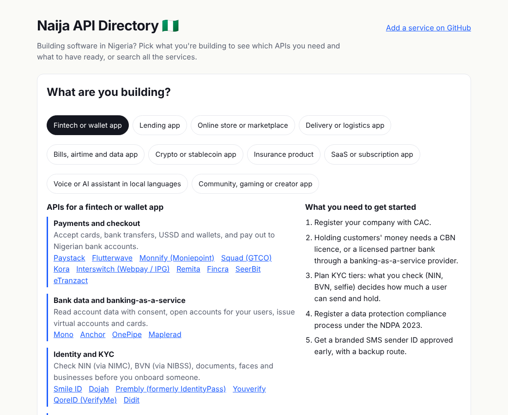

# Naija API Directory 🇳🇬

**Building software in Nigeria? Pick what you're building and see which APIs to use and what you need to get started.** 61 services across payments, KYC, banking-as-a-service, cards, credit, insurance, crypto, messaging, bills, delivery, AI and Nigerian-language speech, plus free reference data.

🔎 **Planner and search:** https://tiwalade-joanna-okedara.github.io/naija-api-directory/

## Why

Building a product in Nigeria means stitching together a dozen outside services, and the useful facts are scattered across docs, blog posts and group chats. This keeps them in one place, organised by what you're building.

Last checked: 2026-11. Inclusion is not an endorsement, and nothing here is legal advice.

## What are you building?

### Fintech or wallet app

**APIs you need:** Payments and checkout, Bank data and banking-as-a-service, Identity and KYC, SMS, OTP, voice and WhatsApp  
**Optional:** Card issuing, Credit and lending data, Bills, airtime and data (VAS), Building blocks (global, work in Nigeria)

**To get started:**
- Register your company with CAC.
- Holding customers' money needs a CBN licence, or a licensed partner bank through a banking-as-a-service provider.
- Plan KYC tiers: what you check (NIN, BVN, selfie) decides how much a user can send and hold.
- Register a data protection compliance process under the NDPA 2023.
- Get a branded SMS sender ID approved early, with a backup route.

### Lending app

**APIs you need:** Credit and lending data, Identity and KYC, Payments and checkout, Bank data and banking-as-a-service  
**Optional:** SMS, OTP, voice and WhatsApp, Building blocks (global, work in Nigeria)

**To get started:**
- Get the right lending licence (for example a state money-lender licence or a CBN licence) and register as a digital lender with the FCCPC.
- Report every loan to at least two credit bureaus, as CBN rules require.
- Collect consent for credit checks and data use.
- Set up collections: direct debit or virtual accounts for repayments.

### Online store or marketplace

**APIs you need:** Payments and checkout, Delivery and logistics, SMS, OTP, voice and WhatsApp  
**Optional:** Identity and KYC, Building blocks (global, work in Nigeria), Insurance

**To get started:**
- CAC documents, director IDs and a business bank account to switch payments to live mode.
- Use split payments or subaccounts so sellers get paid directly.
- Decide who books and pays for delivery, and offer pickup points.
- Verify sellers (ID and business checks) before they list.

### Delivery or logistics app

**APIs you need:** Building blocks (global, work in Nigeria), SMS, OTP, voice and WhatsApp, Payments and checkout, Identity and KYC  
**Optional:** Delivery and logistics, Insurance

**To get started:**
- Verify riders and drivers: ID, address and a liveness check.
- Use maps for addresses, routing and live tracking.
- Send delivery codes by SMS or WhatsApp so drops are confirmed.
- Consider goods-in-transit insurance for parcels.

### Bills, airtime and data app

**APIs you need:** Bills, airtime and data (VAS), Payments and checkout, Identity and KYC  
**Optional:** SMS, OTP, voice and WhatsApp, Bank data and banking-as-a-service

**To get started:**
- Fund a wallet with your VAS provider and monitor the balance.
- Test every biller in the sandbox before launch.
- Give each user a virtual account so top-ups reconcile automatically.
- Keep receipts and a clear refund flow for failed purchases.

### Crypto or stablecoin app

**APIs you need:** Crypto and stablecoins, Identity and KYC, Payments and checkout  
**Optional:** Bank data and banking-as-a-service, SMS, OTP, voice and WhatsApp

**To get started:**
- Check SEC Nigeria's rules for digital asset businesses before you launch.
- Run KYC and AML screening on every user.
- Decide whether you settle in naira, stablecoins or both.
- Show users clear fees and exchange rates.

### Insurance product

**APIs you need:** Insurance, Payments and checkout, Identity and KYC  
**Optional:** SMS, OTP, voice and WhatsApp, Building blocks (global, work in Nigeria)

**To get started:**
- Partner with a NAICOM-licensed insurer, or use an embedded insurance provider that has one.
- Make claims easy to start inside your app.
- Collect premiums with recurring payments.

### SaaS or subscription app

**APIs you need:** Payments and checkout, Building blocks (global, work in Nigeria), SMS, OTP, voice and WhatsApp  
**Optional:** AI, voice and Nigerian languages, Identity and KYC

**To get started:**
- Use recurring billing with naira and dollar pricing if you sell abroad.
- Send receipts and dunning emails for failed renewals.
- Add an AI assistant only where it saves your users time.

### Voice or AI assistant in local languages

**APIs you need:** AI, voice and Nigerian languages, SMS, OTP, voice and WhatsApp  
**Optional:** Building blocks (global, work in Nigeria), Payments and checkout

**To get started:**
- Choose speech models that support the languages your users speak, including Pidgin and code-switching.
- Use a voice API for phone calls and a WhatsApp channel for chat.
- Test with real accents and noisy audio before launch.
- Tell users when they're talking to AI.

### Community, gaming or creator app

**APIs you need:** Payments and checkout, Identity and KYC, SMS, OTP, voice and WhatsApp, Building blocks (global, work in Nigeria)  
**Optional:** Bank data and banking-as-a-service, Card issuing

**To get started:**
- Verify users before paying out prizes or earnings.
- Publish clear rules, fees and payout times.
- Use push notifications and SMS OTP for sign-in and alerts.
- Keep winnings or earnings with a licensed partner, not in your own account.

## All services

**Status key:** 🟢 operating · 🟡 acquired (still operating) · 🔴 shut down

### Payments and checkout

Accept cards, bank transfers, USSD and wallets, and pay out to Nigerian bank accounts.

| Service | What it does | Notes |
|---|---|---|
| 🟡 [Paystack](https://paystack.com) | Online checkout, payment links, subscriptions, transfers and split payments. Cards, bank transfer, USSD and QR. | Acquired by Stripe in 2020. Widely used by Nigerian startups and SMEs. |
| 🟢 [Flutterwave](https://flutterwave.com) | Pan-African payments: cards, transfers, mobile money, USSD and payment links across many currencies. Also offers bills payment APIs. | Good fit if you plan to sell in several African countries. |
| 🟢 [Monnify (Moniepoint)](https://monnify.com) | Collections through dedicated virtual accounts, payouts to any Nigerian bank, and a bills payment API. | Monnify says it was the first Nigerian gateway to offer virtual accounts. |
| 🟢 [Squad (GTCO)](https://squadco.com) | Collections by card, bank transfer and more, from Guaranty Trust's payments arm. |  |
| 🟢 [Kora](https://korahq.com) | Pay-ins and payouts, including card, bank transfer and wallets such as OPay and PalmPay. |  |
| 🟢 [Interswitch (Webpay / IPG)](https://www.interswitchgroup.com) | Long-standing payment gateway and switch. Verve cards, Quickteller and more. | Some developers find the integration heavier than newer gateways. |
| 🟢 [Remita](https://www.remita.net) | Collections and payments, widely used for government and institutional payments. |  |
| 🟢 [Fincra](https://fincra.com) | Pay-ins (gateway, payment links, virtual accounts) and payouts, including cross-border. |  |
| 🟢 [SeerBit](https://seerbit.com) | Payment gateway for cards, transfers and more. |  |
| 🟢 [eTranzact](https://www.etranzact.com) | Payment processing and switching, one of the older Nigerian players. |  |

### Identity and KYC

Check NIN (via NIMC), BVN (via NIBSS), documents, faces and businesses before you onboard someone.

| Service | What it does | Notes |
|---|---|---|
| 🟢 [Smile ID](https://usesmileid.com) | Pan-African ID verification: NIN, BVN, phone and document checks, selfie matching and business checks. |  |
| 🟢 [Dojah](https://dojah.io) | Identity verification, KYC widgets, fraud checks and lookups for African businesses. |  |
| 🟢 [Prembly (formerly IdentityPass)](https://prembly.com) | Identity and business verification APIs for Nigeria and other markets. |  |
| 🟢 [Youverify](https://youverify.co) | KYC, KYB and AML screening for banks and fintechs. |  |
| 🟢 [QoreID (VerifyMe)](https://qoreid.com) | Identity, address and business verification in Nigeria. |  |
| 🟢 [Didit](https://didit.me) | Global identity platform with Nigerian NIN and BVN checks and published per-check pricing. |  |

### Bank data and banking-as-a-service

Read account data with consent, open accounts for your users, issue virtual accounts and cards.

| Service | What it does | Notes |
|---|---|---|
| 🟡 [Mono](https://mono.co) | Open banking: connect bank accounts, read statements and balances, direct debit. | Acquired by Flutterwave in January 2026. |
| 🔴 [Okra](https://okra.ng) | Open banking API. | Shut down in May 2025. Remove it from old integrations. |
| 🟢 [Anchor](https://getanchor.co) | Banking-as-a-service: accounts, transfers, virtual accounts, cards, bill payments and bulk payouts. | Publishes an MCP server so AI coding tools can read its API docs. |
| 🟢 [OnePipe](https://onepipe.io) | Embedded finance through partner banks: accounts, payments and lending products. |  |
| 🟢 [Maplerad](https://maplerad.com) | Accounts, cards and payments infrastructure for African businesses. |  |

### SMS, OTP, voice and WhatsApp

Send OTPs, alerts and messages. In Nigeria, a registered sender ID and a backup route matter.

| Service | What it does | Notes |
|---|---|---|
| 🟢 [Termii](https://termii.com) | SMS, OTP, voice, WhatsApp and email APIs built in Nigeria, with a DND route for transactional messages. |  |
| 🟢 [Africa's Talking](https://africastalking.com) | SMS, voice, USSD and airtime APIs across Africa. |  |
| 🟢 [Sendchamp](https://sendchamp.com) | SMS, voice, WhatsApp and email APIs for African businesses. |  |
| 🟢 [Twilio](https://www.twilio.com) | Global SMS, voice, WhatsApp and Verify APIs. Works for Nigeria, usually at higher local prices. |  |
| 🟢 [WhatsApp Business Platform (Meta)](https://developers.facebook.com/docs/whatsapp) | Official WhatsApp API. Needs a verified Meta business; you pay Meta per message plus any provider fee. | Meta business verification asks for registration documents and a website that match. |

### Bills, airtime and data (VAS)

Sell airtime, data, electricity tokens, cable TV and more inside your product.

| Service | What it does | Notes |
|---|---|---|
| 🟢 [VTpass](https://www.vtpass.com/developers) | Airtime, data, cable TV, electricity, education and insurance payments, with a sandbox. |  |
| 🟢 [Baxi (Onafriq)](https://onafriq.com) | Bill payments through a large agent network and API. Onafriq lists 248 billers. |  |
| 🟢 [Flutterwave Bills](https://developer.flutterwave.com) | Airtime, data, cable, utilities and tax payments from your Flutterwave wallet. Nigerian billers only. |  |
| 🟢 [Monnify Bills Payment](https://monnify.com/products/bills-payment) | Airtime, data, electricity tokens, cable TV and education payments. API only. |  |

### Delivery and logistics

Quote, book and track deliveries inside Nigeria and abroad.

| Service | What it does | Notes |
|---|---|---|
| 🟢 [Shipbubble](https://shipbubble.com) | Shipping aggregator: one API for many couriers (DHL, UPS, GIG, Topship and others), with rate comparison. |  |
| 🟢 [GIG Logistics](https://giglogistics.com/developer) | Courier with APIs for shipping inside Nigeria and internationally. | Contact them for API access details. |
| 🟢 [Kwik Delivery](https://kwik.delivery) | Same-day last-mile delivery API, mainly Lagos and Abuja. |  |
| 🟢 [Sendbox](https://sendbox.co) | Local and international shipping and fulfilment. |  |
| 🟢 [Topship](https://topship.africa) | International shipping from Nigeria. |  |

### Card issuing

Give your users or staff virtual and physical cards.

| Service | What it does | Notes |
|---|---|---|
| 🟢 [Sudo Africa](https://sudo.africa) | Card-issuing API for virtual and physical cards, with spending controls and a sandbox. | Based in Kaduna. |
| 🟢 [Bridgecard](https://bridgecard.co) | Issue Visa or Mastercard cards to your customers through an API. |  |
| 🟢 [Anchor cards](https://getanchor.co) | Create, fund and freeze cards from the same API as accounts and transfers, with webhooks. |  |

### Credit and lending data

Check creditworthiness, screen borrowers and report loans.

| Service | What it does | Notes |
|---|---|---|
| 🟢 [Lendsqr Adjutor](https://adjutor.io) | Credit checks, blacklist screening and income estimation APIs for lenders. | Lendsqr also automates loan reporting to credit bureaus. |
| 🟢 [CreditChek](https://creditchek.africa) | Credit-bureau history and identity checks through an API or no-code dashboard. |  |
| 🟢 [Indicina](https://indicina.co) | Credit decisioning and lending software built around customer data. |  |
| 🟢 [CRC Credit Bureau](https://www.crccreditbureau.com) | Licensed credit bureau with APIs to pull credit reports and submit loan data. | CBN rules require loans to be reported to at least two credit bureaus. |

### Insurance

Sell or embed insurance inside your product.

| Service | What it does | Notes |
|---|---|---|
| 🟢 [Curacel Grow](https://curacel.co) | Embedded life, health, auto and home insurance for fintech, credit, logistics and e-commerce apps. |  |

### Crypto and stablecoins

Accept, pay out or settle in stablecoins.

| Service | What it does | Notes |
|---|---|---|
| 🟢 [Yellow Card API](https://yellowcard.io/api) | Stablecoin-powered payments and settlement across many African countries. |  |
| 🟢 [Quidax](https://www.quidax.io) | Crypto exchange with B2B APIs and liquidity for businesses. |  |
| 🟢 [Busha](https://busha.co) | Crypto exchange offering B2B crypto payment APIs. |  |
| 🟢 [Breet](https://breet.io) | Stablecoin and crypto API that handles wallets, monitoring and settlement, with webhooks. |  |

### AI, voice and Nigerian languages

Speech, voice and AI that understands how Nigerians speak.

| Service | What it does | Notes |
|---|---|---|
| 🟢 [Spitch](https://spitch.app) | Speech-to-text and text-to-speech for Yoruba, Hausa, Igbo, English and Amharic. |  |
| 🟢 [Intron Sahara](https://intron.io) | Speech recognition across 57 languages, including Yoruba, Hausa, Igbo and Pidgin. |  |
| 🟢 [OpenAI API](https://platform.openai.com) | General-purpose language, vision and speech models. | Billed in US dollars. |
| 🟢 [Claude API (Anthropic)](https://docs.claude.com) | General-purpose language models for chat, agents and coding. | Billed in US dollars. |

### Building blocks (global, work in Nigeria)

Auth, database, email, push and maps most apps need.

| Service | What it does | Notes |
|---|---|---|
| 🟢 [Supabase](https://supabase.com) | Postgres database, auth, storage and realtime in one. | Billed in US dollars. |
| 🟢 [Firebase Cloud Messaging](https://firebase.google.com/docs/cloud-messaging) | Free push notifications for Android, iOS and web. |  |
| 🟢 [Resend](https://resend.com) | Transactional and marketing email API. |  |
| 🟢 [Google Maps Platform](https://developers.google.com/maps) | Maps, places search, geocoding and routes. |  |
| 🟢 [Mapbox](https://www.mapbox.com) | Maps, navigation and geocoding, an alternative to Google Maps. |  |

### Free data and open-source helpers

Reference data you'll need on day one: banks, states, LGAs and holidays.

| Service | What it does | Notes |
|---|---|---|
| 🟢 [ng-banks (npm)](https://github.com/BolajiOlajide/ng-banks) | Zero-dependency package listing CBN-recognised Nigerian banks. |  |
| 🟢 [Nigerian Banks API](https://github.com/supermx1/nigerian-banks-api) | Static JSON of Nigerian banks with logos and USSD codes, served from GitHub Pages. |  |
| 🟢 [States and Cities API](https://github.com/devcenter-square/states-cities) | Open-source API for states, cities and LGAs. |  |
| 🟢 [OpenNG](https://openng-docs.vercel.app) | Nigerian public data as a REST API: holidays, states, LGAs, with fuel and food prices planned. |  |
| 🟢 [API Ninjas: Nigeria bank holidays](https://api-ninjas.com/bank-holidays/nigeria) | Nigerian bank holidays by year, useful for settlement and payroll dates. |  |

## Before you launch anything

| Requirement | Why it matters |
|---|---|
| CAC business registration | Most payment, KYC and WhatsApp providers ask for CAC documents before you go live. |
| Nigeria Data Protection Act 2023 (NDPC) | Applies whenever you process personal data of people in Nigeria, including ID checks. |
| CBN open banking framework | Went live on 1 August 2025. Affects how account-data and payment-initiation APIs work. |
| SMS sender ID registration | Branded sender IDs need approval per network. Plan a fallback route. |

## Contribute

Know a service that's missing, closed or renamed, or a step a new builder needs? Edit [`services.json`](services.json) and open a pull request. See [CONTRIBUTING.md](CONTRIBUTING.md).

---
Made by [Tiwalade Joanna Okedara-Kalu](https://github.com/tiwalade-joanna-okedara) · MIT licence
